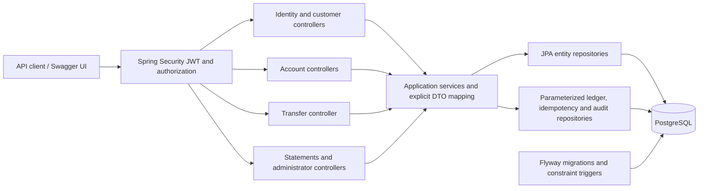

# Architecture

## Scope and boundaries

One Spring Boot application and one PostgreSQL database form a modular monolith. All balances are simulated USD. Package boundaries describe responsibilities without introducing remote services or generic framework layers.



| Package | Responsibility |
| --- | --- |
| `identity`, `security` | Credentials, role assignment, token issuance/validation, stateless request security, authentication rate limits |
| `customer` | Private profile creation/read/update; editable name and phone, immutable login email in the MVP |
| `account` | Ownership, account summaries, opening and closing accounts, lifecycle and balance rules |
| `transfer` | Customer-scoped idempotency, locking, validation, persisted successful/rejected outcomes |
| `ledger` | Posting balanced movements within an existing transaction |
| `demo` | Opt-in local administrator bootstrap and bounded one-time funding |
| `history` | Authorized statement queries with repeatable-read snapshots |
| `admin`, `audit` | Freeze/unfreeze, aggregate operations, separate immutable audit records |
| `shared`, `config` | Money rules, Problem Details, bounded page envelopes, OpenAPI metadata |

Controllers validate input and resolve authenticated subjects. Services enforce business rules and define transaction boundaries. Repositories persist entities or run parameterized SQL. JPA entities never become REST responses; DTOs contain explicit allowed fields. UUIDs serve as opaque resource identifiers; authorization is still required for every object lookup.

## Internal transfer

```mermaid
sequenceDiagram
    actor Customer
    participant API as Security / Controller
    participant Service as TransferService
    participant Keys as IdempotencyRepository
    participant DB as PostgreSQL
    participant Ledger as LedgerService
    Customer->>API: POST /api/v1/transfers + JWT + Idempotency-Key
    API->>API: Authenticate, authorize role, validate DTO
    API->>Service: Authenticated customer, key, request
    Service->>DB: BEGIN (read committed, bounded timeout)
    Service->>Keys: INSERT key ON CONFLICT DO NOTHING
    Keys->>DB: Wait for conflicting transaction; SELECT FOR UPDATE
    Keys-->>Service: Stored fingerprint and transfer ID
    alt Existing key, different payload
        Service->>DB: ROLLBACK
        Service-->>API: 409 IDEMPOTENCY_CONFLICT
    else Existing completed request
        Service->>DB: Read original customer-owned transfer; COMMIT
        Service-->>API: Original outcome
    else New request
        Service->>DB: Lock both accounts in UUID order
        Service->>Service: Check source ownership, currency, states, funds
        alt Business rejection
            Service->>DB: Insert REJECTED transfer, complete key, audit
        else Eligible
            Service->>Ledger: Post debit and credit
            Ledger->>DB: Insert journal and immutable entries
            Ledger->>Service: Update locked balance caches
            Service->>DB: Insert SUCCEEDED transfer, complete key, audit
        end
        Service->>DB: COMMIT; deferred balancing/reconciliation checks
        DB-->>Service: Commit succeeds or entire transaction rolls back
        Service-->>API: 200 success or 409 persisted rejection
    end
    API-->>Customer: Response or Problem Details
```

## Concurrency and failure behavior

The unique `(customer_id, request_key)` index serializes duplicate requests. PostgreSQL waits on an uncommitted conflicting insert. At read committed isolation, the subsequent locked select observes its committed outcome. A failed first transaction leaves no committed key; a waiting request may then perform the operation. A deferred constraint prevents incomplete keys from committing.

Every money writer locks account rows in the same Java UUID ordering. Different keys spending the same source therefore see the latest committed balance in sequence. Opposing transfers take locks in the same order. Funding follows the same ordering, including the clearing account. Freeze/unfreeze and closure lock the account they change, so lifecycle checks serialize with movements.

Transfer lock waits are capped at five seconds and transaction work at fifteen seconds. Contention produces a retryable `503` with `Retry-After: 1`; callers retry with the same key. There is no hidden automatic retry loop. Normal business rejections persist without ledger entries; malformed, missing, or unauthorized resources roll back the attempted key. Unexpected failures roll back balances, entries, journal, transfer, idempotency, and audit together.

Timestamp precision is normalized to PostgreSQL microseconds before creating a transfer response, preserving exact replay equality after persistence. Payload fingerprints use source UUID, destination UUID, fixed USD, and a normalized two-decimal amount; `1` and `1.00` are equivalent.

## Read consistency and tradeoffs

Statement balances, ledger totals, page counts, and rows use a repeatable-read snapshot. Statements have an inclusive `from`, exclusive `to`, and timestamp/UUID sorting in either direction. Offset pagination is bounded but is not a historical snapshot across separate HTTP requests; insertions can shift pages between requests.

JPA and JDBC share the same datasource and Spring-managed transaction. JDBC is used where PostgreSQL's `ON CONFLICT` and append-only SQL are clearer than entity state management. Deferred reconciliation scans account ledger history at commit. This is deliberately strong and easy to inspect for a portfolio-sized database, but adds write cost as history grows. A real high-volume system would need measured throughput goals and a different verification strategy.

All business and infrastructure dependencies run in one process. There is no message broker, cache, microservice network, frontend, or cloud deployment.
