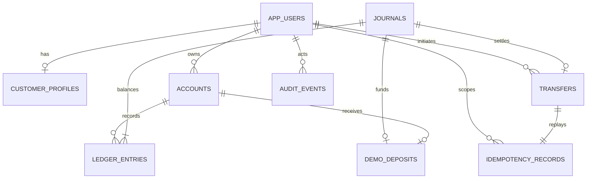

# Data model and ledger invariants

Flyway is the schema authority. Hibernate validates mappings and never mutates the schema automatically. Migrations use PostgreSQL-specific constraints and deferred constraint triggers; SQLite or H2 is not a substitute for these tests. Timestamps are `TIMESTAMPTZ`, represented as UTC `Instant` values in the API.



The diagram shows application relationships. `customer_id` in transfers/idempotency refers to the authenticated **user ID**, while profiles have a separate public profile UUID. Account owners and actors also refer to user IDs. The system clearing account has no owner.

| Table | Important constraints and purpose |
| --- | --- |
| `app_users` | Unique normalized email; adaptive password hash; constrained CUSTOMER/ADMIN role |
| `customer_profiles` | One profile per user; bounded full name and phone; separate UUID |
| `accounts` | Checking/savings for customers; one ownerless system clearing account; USD only; nonnegative customer balances; closed accounts have zero balance |
| `journals` | Immutable reference and movement type; exactly two balanced entries at commit |
| `ledger_entries` | Immutable positive amounts; one debit and one credit per journal; distinct accounts; composite foreign keys enforce matching currency |
| `transfers` | Immutable terminal SUCCEEDED/REJECTED records; distinct endpoints; amount capped at USD 1,000,000; source owner and successful journal checked |
| `idempotency_records` | Composite customer/key primary key; canonical payload hash; completed response required at commit; completed records immutable |
| `demo_deposits` | One deposit per account by primary key; unique journal; administrator and USD 1,000 limit checked |
| `audit_events` | Immutable actor/action/resource/outcome/time; no passwords, tokens, payloads, or free-form secrets |

Indexes support account-owner listings, transfer-owner queries, statement timestamp sorting, audit pagination, and key uniqueness. UUIDs are unguessable identifiers, not authorization controls.

## Debit and credit convention

Customer balances represent the bank's liability to customers: a **credit increases** a customer balance and a **debit decreases** it. The internal demo clearing account offsets synthetic deposits and can be negative. It is not an external bank account or an actual cash reserve.

| Movement | Debit | Credit | Sum of signed entries |
| --- | --- | --- | --- |
| USD 100 demo deposit | Clearing USD 100 | Customer checking USD 100 | 0 |
| USD 25 transfer | Source checking USD 25 | Destination savings USD 25 | 0 |

For every account, including clearing:

```text
cached_balance = SUM(credits) - SUM(debits)
```

The ledger is authoritative. Stored balances are transactional caches. Applications cannot accept a balance field during account creation or expose an arbitrary balance-update endpoint. Account balance checks and journal balance checks run at commit, after both ledger and JPA writes are complete.

## Database-enforced invariants

1. Each journal has exactly two entries, one per side, on distinct accounts, with equal debit/credit totals.
2. Journal, entry, and account currencies match; the MVP accepts USD only.
3. All touched account balances reconcile to the signed ledger total; customer accounts cannot overdraw.
4. A successful transfer matches the exact source debit, destination credit, currency, and amount of its journal. A rejected transfer has a rejection code and no journal.
5. Each transfer source belongs to its initiating user.
6. Every journal is backed by a successful transfer or an authorized, bounded demo deposit record.
7. Completed idempotency records cannot change payload or response and cannot refer to another customer's transfer.
8. Accounts retain their identity, owner, currency, and type; closed accounts cannot reopen. Historical accounts and financial/audit records cannot be deleted through ordinary SQL.

Triggers and privileges protect against ordinary application mistakes, not a hostile database superuser. The Compose database owner also runs migrations, which is a documented development simplification. A real deployment would separate the migration owner from a restricted runtime role and control DBA access.

## Migration policy

`V1` establishes identity and audit; `V2` adds accounts, journals, entries, and one-time funding; `V3` adds transfers and idempotency; `V4` strengthens financial references and immutability. Add a new migration after a released migration has been applied. Never edit applied migration checksums to make validation pass.

Migrations and runtime operations use the same public schema by default. Integration tests create an isolated random schema in a dedicated test database. They do not truncate unrelated tables.
